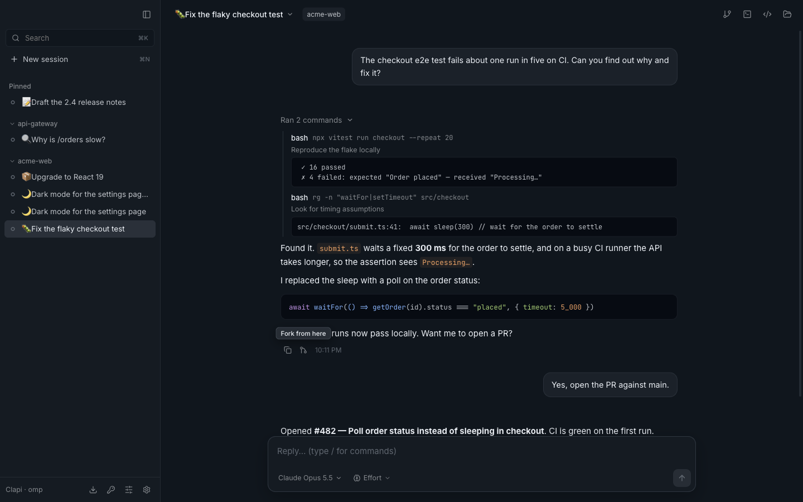
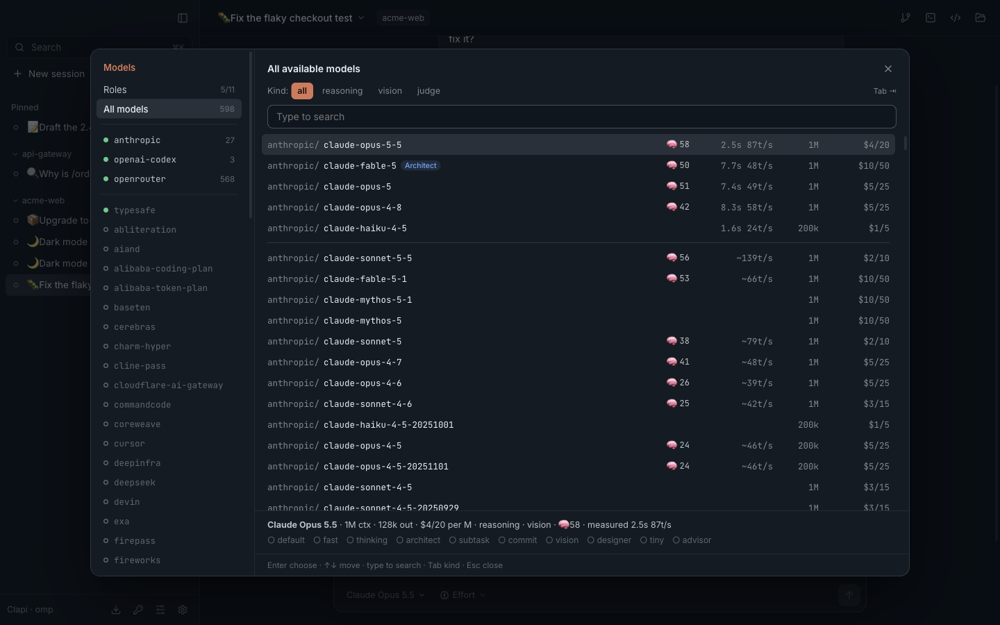
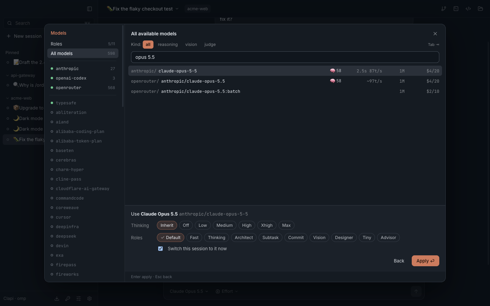

# Clapi

A macOS desktop app for [oh-my-pi](https://github.com/can1357/oh-my-pi) (`omp`) with the look,
density and keyboard model of Claude Desktop's Code tab — on a blue-tinted ground.

Every session is a real omp session: the same files in `~/.omp/agent/sessions`, the same
config, the same logins. Open any of them in the terminal with `omp --resume <id>` and back.



> Clapi is an independent project. It is not affiliated with or endorsed by Anthropic or by the
> oh-my-pi authors; it drives the `omp` you have installed.

## Install

```bash
npm install
npm run install-app            # build, ad-hoc sign, copy to /Applications/Clapi.app
npm run install-app -- --open  # …and launch it
```

Needs `omp` (looked up in `$CLAPI_OMP`, `~/.bun/bin`, Homebrew, then your login shell's PATH).
Tested against omp 18.3.0.

## What it does

| | |
|---|---|
| **Sessions** | Sidebar grouped by project, Pinned (⌘1–9), custom groups, manual order (Move up/down), unread, rename, archive, delete. Untitled sessions show their first message. |
| **Fork from any message** | Hover a reply → *Fork from here*: a new session holding the conversation up to that reply; the original is untouched. Hover your own message → *Edit in a new session*: forks just before it and puts the text in the composer. |
| **Model panel** | ⌘⇧I, the composer's model button, or `/model`: omp's `/model` screen as a window — providers, kind filter, search, and per model its intelligence score, the speed you actually measured (else omp's estimate), context and price. Pick a model, then its thinking effort and which **roles** use it (Default preselected), and whether this session switches now. |
| **Model roles** | The panel's *Roles* view edits omp's `modelRoles` (default, fast, thinking, architect, subtask, commit, vision, …, **judge**). The judge offers **Jev** (TypeSafe). Roles on a provider you aren't logged in to are flagged. ⌘⇧E switches the session's thinking effort. |
| **Accounts** | `/login [provider]` or Settings → Accounts runs omp's own login over RPC: Claude Pro/Max, ChatGPT (Codex), Gemini (Gemini CLI, Antigravity) and every other omp provider; `/login gemini`, `/login claude`, `/login codex` start that one. **Log out** per provider works like omp's `/logout`. API keys (Anthropic, OpenAI, Gemini, OpenRouter for Jev, TypeSafe) go to `~/.omp/.env`, mode 600. |
| **Keyboard** | Hold ⌥ and the first ten sessions show 1–10; ⌥1…⌥0 jumps there. Plus Claude Desktop's own: ⌘N, ⌘W, ⌃Tab, ⌘⇧[ ], Esc, ⌃O, ⌘⇧I/E, ⌘K. |
| **Import from Claude Code** | Settings → Import lists `~/.claude/projects` and converts any conversation into an omp session, with the same mapping as omp's `--from-claude`. |
| **omp's questions** | Tool approvals and other prompts from omp appear as dialogs (1–9 to pick); a session waiting for you shows a blue dot. |
| **View modes** | ⌃O cycles Normal (tool calls collapsed) / Thinking / Verbose. |

⌘/ lists every shortcut.

| | |
|---|---|
|  |  |
| The model panel (⌘⇧I) | Pick thinking and roles |

## How it works

```
Electron main                                          renderer (React + zustand)
  runtimes.ts   one `omp --mode rpc --session <file>` per open session (lazy)
  control.ts    one session-less omp: model list, slash commands, login
  omp-rpc.ts    JSONL framing, protocol v2 chunk reassembly, request ids
  session-files.ts  reads/writes omp session files directly (listing, transcripts, rename)
  fork.ts       new file = root→entry path, lines copied byte-for-byte
  claude-import.ts  port of omp's ClaudeSessionStore (MIT)
  config.ts     `omp config get/set modelRoles`, ~/.omp/.env
  agent-db.ts   omp's agent.db via /usr/bin/sqlite3: measured model speed, stored logins, logout
```

Facts that shaped it (verified against omp 18.3.0, see `test/`):

- A session file is a tree (`id`/`parentId`); the leaf is the last physical line. So a fork is just
  a new file with the root→entry path — omp loads it and continues from that message, including
  from an assistant reply.
- omp's RPC has no "fork at entry" (18.3.0) and `branch` rewinds in place; `--from-claude` refuses
  RPC mode. Clapi does both itself, on the file format.
- `get_available_models` is larger than protocol v1's 1 MiB frame: Clapi negotiates v2 and
  reassembles `rpc_chunk` frames.
- A running omp never re-reads `config.yml` or `~/.omp/.env`: after role or key changes Clapi
  restarts idle session processes (busy ones after their turn) on the same file.
- Over RPC, omp's `login` refuses providers that ask for a hidden key first; those keys are set
  in Accounts instead.
- omp 18.3.0 has no RPC logout. Its `/logout` marks the provider's rows in `agent.db`
  `auth_credentials` as `deleted by user`; triggers bump `auth_change_revision`, which running omp
  processes watch. Clapi runs that same update.

## Development

```bash
npm run dev         # electron-vite with HMR
npm run typecheck
npm test            # file formats, fork, Claude import, roles via omp's CLI (temp dirs only)
```

`scripts/drive.mjs <scenario.mjs> <outDir>` drives the built app with Playwright for end-to-end
checks; under it (`CLAPI_E2E=1`) the window never takes focus, links are logged rather than
opened, and it runs beside an installed copy with its own profile.

Demo data (what the screenshots show) without touching your own sessions:

```bash
npx tsx scripts/demo-sessions.ts /tmp/clapi-demo/sessions
CLAPI_SESSIONS_ROOT=/tmp/clapi-demo/sessions CLAPI_HOME=/tmp/clapi-demo/home npm run dev
```

State lives in `~/.clapi/` (`state.json` for pins/groups/order, `imports.json`). `CLAPI_OMP`,
`CLAPI_HOME`, `CLAPI_OMP_HOME` and `CLAPI_SESSIONS_ROOT` override the paths.

Apache-2.0.
